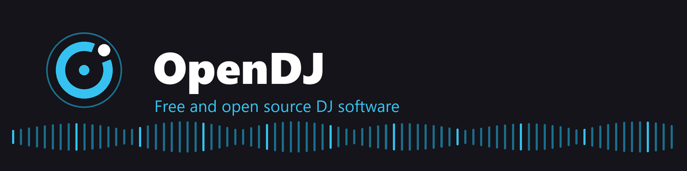

<p align="center">
  
</p>

| Branch | Build and tests |
| --- | --- |
| [`main`](https://git.interdo.me/interdome/opendj/actions?workflow=build.yml&branch=main) | [](https://git.interdo.me/interdome/opendj/actions?workflow=build.yml&branch=main) |
| [`testing`](https://git.interdo.me/interdome/opendj/actions?workflow=build.yml&branch=testing) | [](https://git.interdo.me/interdome/opendj/actions?workflow=build.yml&branch=testing) |

Free and open source DJ software, built in C++ with [JUCE](https://juce.com).

![A strip across the top lining up both decks' beats, decks A and B below it, each with a track loaded and its waveforms coloured by frequency, loop lengths, stem knobs, turntable platter, tempo fader and a button to swap in deck C or D, a four channel mixer between them with every control named on every channel: high, mid and low EQ, filter, echo and its length in beats, reverb, crossfader assignment, a channel fader and cue, the track library underneath showing tempo and key, a row of eight sampler pads with their own level and cue, aux and mic strips with talkover on the mic, and a bottom bar with audio setup, recording, Icecast and RTMP streaming, controller setup, and the audio device running at 10 ms](images/screenshot.jpg)

The goal is an application a VirtualDJ user can sit down at and already know how to use:
the same deck layout, the same workflow, the same muscle memory. The artwork, the naming
and the code are entirely original and entirely open.

**Status: early development, but it mixes.** Four decks with turntable platters you can scratch,
waveforms, beat grids, automatic BPM and key detection, sync, key lock, beat-locked loops and
rolls, key shift and key match, stem separation with a knob per stem, a mixer with a filter, a beat-synced echo and a reverb per channel, two master effect units, brake, backspin, reverse and censor, hot cues, an eight slot sampler, a
searchable track library, set recording to WAV, FLAC or MP3 with a tracklist, broadcasting to Icecast, and Roland
DJ-202 support including its own audio interface and its platters.

## Design goals

- **Real audio performance.** ASIO and JACK support, multi-device routing, and a realtime
  safe engine that never allocates or locks on the audio thread.
- **Hardware first.** A data-driven MIDI mapping layer with the Roland DJ-202 as the
  reference controller. Mappings are JSON files, so a new controller needs no recompile.
- **Free, in both senses.** GPLv3, no paid tier, no locked features.

## Roadmap

See [ROADMAP.md](ROADMAP.md) for what is done, what is left, and where to start. The short
version: everything in the first milestone now works, along with effects, loops, a sampler and
four decks.

## Using it

The [wiki](https://git.interdo.me/interdome/opendj/wiki) is the full guide, covering every control
on screen. What follows is the short version.

Load a track from the library underneath, with the Load button on either deck, by dragging an
audio file in from a file manager, or by naming files on the command line to start with them
already loaded. Decoding
and analysis run in the background, so the interface stays responsive on a long file. Click the
overview waveform to move through the track.

Each deck shows a scrolling waveform with the beat grid drawn over it, bar lines brighter than
beats, and the detected tempo next to the title. Sync matches this deck's tempo and beat phase
to the other one.

Both waveforms are coloured by frequency: red is bass, green the midrange and blue the treble,
so a drop reads orange, a breakdown loses its red and a hi-hat pattern on its own comes out
blue. The three bands are split at the same frequencies the mixer's EQ uses, so turning the Low
knob down takes exactly the red out of what you can hear.

The wheel over a scrolling waveform zooms it, from half a second either side of the playhead out
to twenty-four: in to place a cue on the beat, out to see the shape of a phrase. Both decks move
together, so the two are always at the same scale, and where it was left is where it opens.

Across the top of the window is a strip with a row for each deck on screen, a tick for every beat
and one playhead down the middle. When the decks are in phase the ticks line up into columns
through both rows; when they are not, they stagger by exactly as much as the decks are out. Every
fourth beat is drawn full height, because matching the tempo is not the same as matching the beat
the phrase turns on.

The platter turns at 33 1/3 rpm against the track position, so it is a readout and not
decoration: if it is crawling, the deck is crawling. Drag the middle of it to scratch, exactly
as if you had a hand on the record, and drag the outer ring to nudge the pitch without stopping
playback. The rim flashes on every beat, which is a second way to see two decks drifting apart
without reading the waveforms.

Key lock is the `Key` button on each deck. With it on, the tempo fader changes the speed and
leaves the pitch where the record put it; it steps out of the way while you have a hand on the
platter, because a time stretcher cannot follow a scratch and nobody expects a scratch to be in
key.

| Key | Action |
| --- | --- |
| Q / W | Deck A cue / play |
| O / P | Deck B cue / play |

Cue follows the behaviour DJs expect. While the deck is stopped, pressing cue sets the cue
point and previews from it, and releasing returns and stops. While it is playing, pressing
cue drops straight back to the cue point and stops there.

At the end of each deck's row of hot cue pads, the arrows jump back or forward by whole beats, so a synced
deck stays in phase. The number between them is the size. Click it to step through 1, 2, 4, 8,
16 and 32 beats. A running loop moves with the jump. `Q` turns quantize on for that deck. With
it on, the cue point, a newly set hot cue, and loop in and out snap to the nearest beat instead
of landing where the click did. Quantize is remembered per deck.

When the detected grid is wrong, click the deck's BPM readout to edit it:

- **Tempo:** step it by 1, 0.1 or 0.01 BPM, or halve or double a track found at the wrong speed.
  The beat nearest the playhead stays where it is, and the grid stretches from there.
- **Phase:** Earlier and Later slide the whole grid by 5 ms, and Downbeat here makes the playhead
  the first beat of a bar.
- **Tap:** tap along with the beat. Four taps set the tempo, and every tap after that refines it.
  Stop for two seconds to start over. Tap also gives a grid to a track that has none.
- **Revert:** puts back the grid the track had when it was loaded.

Edits apply at once, so the waveform, sync, loops and automix all follow while the editor is
open. Each edit is saved with the track in the library, and a later analysis or rekordbox import
won't replace it. If the file itself changes, it gets a fresh analysis.

## Performance effects

The row of buttons under the hot cues works on that deck:

- **Brake** slows the deck to a stop in a second, with the pitch falling, the way a turntable does when the power is cut.
- **Spin** flings the record backwards at four times its speed and lets it die away over a second and a half.
- **Rev** plays backwards until you press it again.
- **Censor** plays backwards for as long as you hold it. The track keeps running underneath, so letting go lands where it would have reached.
- **Echo out** takes the track away and leaves its echo dying out, wherever the Echo knob is. Press it again to bring the track back. Loading a new track also turns it off.

With **Slip** on, Brake and Spin drop back in on time instead of stopping the deck, and Rev lands where the track would have reached when you turn it off. Pressing Play during a Brake or Spin puts the deck straight back at its tempo.

The two master units over the whole mix hold an echo, reverb or filter, a VST3 plugin, or one of these:

| Effect | First knob | Second knob |
| --- | --- | --- |
| Flanger | One sweep every 1 to 32 beats | Feedback |
| Phaser | One sweep every 1 to 32 beats | Depth |
| Gate | Chops the mix every 1/8 of a beat to 4 beats | How long it stays open in each cycle |
| Bitcrusher | Bits, from 16 down to 2 | How many samples it holds each value for |
| Stutter | Repeats the last 1/8 of a beat to 4 beats while on | How fast the repeats fade |

The gate and the sweeps follow the beat grid of the deck the room is hearing, so they land with the music whenever you switch them on.

## Keys

The readout at the end of the row under the hot cues is the key the deck is playing in now. The
buttons beside it move it a semitone at a time without changing the tempo, up to an octave either
way, and a number beside the key says how far it has been moved. A new track starts back at its own
key. With Key lock off, the tempo fader moves the pitch as well, and the readout follows it to the
nearest semitone.

Click the readout to match the deck that a sync would follow. It takes the shortest way to that key
or its relative, which has the same notes, so A minor already matches C major and doesn't move.

**Camelot** in the library toolbar shows keys as wheel numbers, 8A rather than Am, there and on the
decks, and is remembered. Click the Key column to sort by the wheel, with tracks that have no key last.

While a deck plays, the library shows what would mix with it. A key in bright green is the same key,
and pale green is its relative or a step round the wheel. The key it goes by is the one being played
after any shift, from the deck the room is hearing or, with every fader down, a playing deck.

## Four decks

There are four decks, A to D, and two of them are on screen at a time. The button beside a
deck's clock swaps it for the one behind it, A for C on the left and B for D on the right, so
both visible decks stay wide enough to read a waveform on.

Each deck has its own mixer strip. The small box on the strip says which side of the crossfader
that channel answers to: A, B, or neither. C and D start on neither, which is how a third deck
is usually used, and any channel can be moved onto either side.

Q, W, O and P follow the side rather than the deck, so they keep meaning the deck on the left
and the deck on the right after a swap. Sync matches the nearest deck that is playing and has a
beat grid.

## Broadcasting

Press Stream in the bottom bar, fill in your server, and press Go live. OpenDJ encodes the master
output as Ogg Vorbis and sends it to any Icecast server, which covers Icecast itself, most
internet radio hosts, and the Icecast-compatible half of Shoutcast. The button counts up while
you are on air and the status bar says where to.

A dropped connection comes back on its own, waiting a little longer after each failure, and the
music in the room never stops while it does. If the network cannot keep up, the stream loses
those samples rather than the room losing audio, and the status bar says so.

Two honest limitations. Track titles do not show on an Ogg mount, because Icecast carries Ogg
metadata inside the stream and its title mechanism is for MP3 sources. And your listeners hear
you a few seconds late, which is true of every internet radio stream.

Your server password is stored in the settings file in clear text, as it is in every DJ
application. The dialog says so too.

YouTube, Twitch and Mixcloud are not supported yet. All three need an H.264 video track and will
not accept audio alone, so they need a different machine underneath: see
[ROADMAP.md](ROADMAP.md).

## The sampler

A row of eight pads under the browser holds short sounds, played over whatever the decks are
doing. Click an empty pad to load one, or drop a file onto it. Click a loaded pad to fire it,
shift-click to stop it, and right-click for Loop, Sync, Record from a deck, Stop and Clear. The
number keys 1 to 8 fire the same eight pads.

There are four banks of eight. The Bank button under the heading puts the next bank on the pads.
A sound keeps playing when its bank is put away, and a dot on the button means one is still
playing in a bank that's not on show.

**Record from a deck** takes a sample straight from a track on a deck that has a beat grid. If
the deck is looping, it takes the loop; otherwise it takes 1, 2 or 4 bars from the beat at the
playhead. It's cut from the track itself rather than the deck's output, so it lands exactly on
the grid, without the EQ or effects. Each one is saved as a WAV in `OpenDJ/Samples` in your user
application data folder, so the pad comes back after a restart.

**Sync** makes a pad play at the tempo of the music rather than its own: the lowest-lettered
playing deck with a beat grid, at its pitch. Like a record, its pitch moves with its speed. A
sample recorded from a deck already knows its tempo. A loaded file over four seconds long has
its tempo detected, and shorter sounds are treated as one-shots with no tempo. A tempo half or
double the sample's own counts as the same beat, and a pad further out than half again either
way plays as recorded.

The knob beside them is the level of the whole sampler, and Cue sends it to the headphones as
well as the room, so a sound can be found before anybody else hears it.

OpenDJ picks the best audio backend it can find rather than the first one offered. On Windows
that means **Windows Audio (Low Latency Mode)** by default, with ASIO ahead of it when you have
built with the SDK, then shared or exclusive Windows Audio, and DirectSound last because it
cannot do low latency. On Linux it means JACK or PipeWire ahead of ALSA. It also asks a device sitting on a huge buffer for a smaller one. On a
plain Windows desktop that is the difference between 87 ms of output latency and 7 ms.

## The mic

Plug a mic into your interface, choose that input in Audio setup, and use the strip at the end of
the sampler row. On puts it on air. It is always off when OpenDJ opens, so a mic left in front of
the speakers cannot howl the moment the application starts. The knob is its level, and the bar
beside it shows what the mic hears even while it is off, so the level can be set before anybody
hears you.

Talkover drops the music by 10 dB while the mic is on, and brings it back over half a second when
you switch the mic off. Everywhere sends your voice to the speakers, the recording and the
stream. Stream only keeps it out of the speakers but still puts it in the recording and the
stream, for talking to listeners from a room with the speakers in it. The mic is not sent to the
headphones.

The `In 1-2` button picks which pair of the device's inputs the mic listens to. Click it to step
to the next pair. A mic is mono, so the two inputs of its pair are summed, and a mic on either
one arrives at full level.

## The aux input

Beside the mic is a second strip, Aux, for a stereo line laid over the mix: browser audio, system
audio, a phone, or a second player. It works like the mic, with On, a level, a meter, and
Everywhere or Stream only, but it keeps left and right apart and has no talkover. Talkover on the
mic ducks the aux along with the music. Like the mic, it is always off when OpenDJ opens.

The aux reads inputs 3 and 4 unless you pick another pair, so turn on four inputs in Audio setup:
the mic's pair and the aux's.

Browser or system audio needs an input to arrive on. Audio setup opens one input device at a time,
so it has to be the same device the mic is on:

- **Windows:** route the browser into a virtual cable such as VB-Cable or VoiceMeeter, and pick
  that as the input device. "Stereo Mix", where the sound driver offers it, also works, but it
  then carries everything the computer plays, including OpenDJ itself.
- **macOS:** BlackHole or Loopback do the same job.
- **Linux:** PipeWire and PulseAudio can offer a monitor of any output as an input.
- **Audio interfaces:** many have a loopback channel pair built in, which is the simplest way to
  get a mic and the computer's audio on one device.

## Headphones on a stereo interface

Headphone cue normally lives on outputs 3 and 4, which a four channel interface such as the
DJ-202's has and a plain sound card does not. Audio setup offers a split instead: the master on
output 1 and the cue on output 2, both in mono, for use with a splitter cable. One half goes to
the speakers and the other to the headphones.

It is off unless you choose it, because a split puts a mono master into one speaker, and the
choice is remembered.

## What it remembers

The audio device you picked, the master and headphone levels, the crossfader curve and which
channels answer to it, the tempo fader ranges, which decks are on screen, your sampler pads,
and the window's size and position. They live in `settings.json` beside the library database,
as plain JSON you can edit.

The decks themselves are deliberately not restored, and neither are the channel faders. Starting
quiet, with nothing playing, is the only safe way for a DJ application to open.

## The library

Point OpenDJ at a folder with **Add folder** and it reads the tags of everything inside, which
takes seconds rather than minutes because it parses ID3 directly instead of opening a decoder
for every file. It then works through the collection in the background, at low priority, finding
the tempo and beat grid of each track and remembering it, so a track you load later is on the
deck immediately instead of being analysed again.

Search matches every word you type against the artist, title, album and path, so `boys noize
2007` narrows as you would expect. Click a column to sort, double-click a row to load it onto a
deck that is not playing, or drag it onto the deck you meant.

The database is a single SQLite file, in `~/.config/OpenDJ` on Linux. Deleting it costs you the
analysis and nothing else.

Tempo detection was checked against 60 tracks from a 13,000 track techno collection, and agrees
with Mixxx on 57 of them; [ROADMAP.md](ROADMAP.md) has the detail and the method.

## Recording a set

Press Record in the bottom bar. The master output goes to your music folder under OpenDJ,
named for the date and time, and the button turns red and counts up while it runs. Press it
again to stop.

Right-click Record for the format and the folder. 24-bit WAV is the default and 24-bit FLAC
holds the same audio in about half the space; MP3 is there for sending somebody the set, at
320, 256 or 192 kbps or LAME's variable V0. Nothing has to be installed for any of them.

Beside the audio you get a text file listing what you played and when, timed against the
recording rather than the clock. Whatever was already playing when you pressed Record is the
first entry.

If the disk cannot keep up, the recording loses those samples rather than the room losing
audio, and you are told: in the status bar while it happens, in the dialog when you stop, and
in the tracklist file, which is the one still there tomorrow.

## Controllers

Press Controller in the bottom bar to pick a MIDI device and a mapping, and to watch what the
hardware is actually sending. Every message is listed with the control it matched, or as
unmapped, which is how you check a mapping against real hardware or work out what an
unsupported controller sends.

Mappings are JSON files in `mappings/`, not code. Copy one, change the numbers, and your
controller works without rebuilding anything. A control with a mistake in it is skipped with a
warning shown in that panel, so one typo costs you one button rather than the whole device.

A recognised controller is opened automatically at startup.

## Building

You need a C++20 compiler, CMake 3.22 or newer, and git. JUCE and Catch2 are fetched into
`external/` at configure time, so the first configure needs a network connection and takes a
few minutes.

### Linux

One script covers Fedora, Debian and Arch. It installs the right packages for whichever
package manager it finds, then builds.

```
scripts/build.sh --deps     # install system dependencies, once
scripts/build.sh            # configure and build
scripts/build.sh --run      # and launch it
```

On **Fedora** the dependencies are:

```
sudo dnf install -y \
    gcc-c++ cmake ninja-build git pkgconf-pkg-config \
    alsa-lib-devel pipewire-jack-audio-connection-kit-devel sqlite-devel \
    freetype-devel fontconfig-devel \
    libX11-devel libXext-devel libXinerama-devel \
    libXrandr-devel libXcursor-devel libXcomposite-devel \
    mesa-libGL-devel
```

Fedora 40 and newer route JACK through PipeWire, so the package above is the one to install
rather than `jack-audio-connection-kit-devel`; the two conflict. On an older release, or a
system deliberately running classic JACK, swap it for `jack-audio-connection-kit-devel`. The
build script picks whichever is available.

For low latency, run OpenDJ through JACK or PipeWire rather than plain ALSA, and pick that
device in Audio setup. PipeWire presents itself as a JACK server, so nothing extra is needed
on a stock Fedora desktop.

The MilkDrop visuals behind the Visuals button come with an idle preset and nothing else until
you fetch a library for them; `scripts/get-presets.sh` installs 14,575 of them. They are fetched
rather than shipped: see [ROADMAP.md](ROADMAP.md) for why.

### Windows

A fresh machine needs Visual Studio 2022 Build Tools (C++ workload) and git. Its bundled CMake
and Ninja are found and used automatically. `build.ps1` offers to install whatever is missing
through winget, or you can do it up front. The same script installs ffmpeg (with libx264), which
RTMP broadcasting needs at runtime, and the pieces for stem separation: Intel's OpenVINO runtime from winget and
the htdemucs model (about 105 MB, from Hugging Face, into `~/.local/share/opendj/models`). OpenDJ finds winget's
ffmpeg without a restart of the shell, and `build.ps1` finds OpenVINO and copies its DLLs next to the program.
On a machine with an NVIDIA card it also fetches ONNX Runtime, NVIDIA's CUDA and cuDNN libraries (about 2.2 GB)
and an ONNX copy of the model, so stems separate on the GPU, four times as fast as on the CPU; the Stems
button's tooltip says which device is in use.
Add `-SkipStems` to leave the stem pieces out:

```
pwsh scripts/setup-windows.ps1   # install requirements (-Check only looks)
```

```
pwsh scripts/build.ps1         # configure and build
pwsh scripts/build.ps1 -Test   # and run the tests
pwsh scripts/build.ps1 -Run    # and launch it
```

The MilkDrop visuals behind the Visuals button come with an idle preset and nothing else until
you fetch a library for them; `scripts/get-presets.ps1` installs 14,575 of them into
`%APPDATA%\OpenDJ`. They are fetched rather than shipped: see [ROADMAP.md](ROADMAP.md) for why.

### macOS (Apple Silicon first)

Use the separate macOS script; the Linux and Windows scripts are unchanged.
Install Xcode or Apple's Command Line Tools (`xcode-select --install`), then:

```sh
scripts/build-macos.sh --deps                  # install CMake and Ninja with Homebrew
scripts/build-macos.sh --test                  # native build and tests
scripts/build-macos.sh --run track-a.wav       # native build and launch
scripts/build-macos.sh --arch universal --release  # Apple Silicon + Intel app
scripts/build-macos.sh --arch x86_64 --test     # Intel tests through Rosetta on Apple Silicon
```

The default is the hardware's native architecture, with a minimum macOS version
of 12.6. Use `--deployment-target VERSION` to change that minimum. Each architecture
and configuration has its own build and dependency directory under `build-macos/`.
The resulting app is at
`build-macos/<arch>/<configuration>/OpenDJ_artefacts/<configuration>/OpenDJ.app`;
copy the entire app bundle to run it elsewhere. The controller mapping is bundled
inside it. `--clean` removes only the selected architecture/configuration.

The script applies an ad-hoc signature for local development. Public downloads
still need Developer ID signing and notarization. Rosetta exercises the Intel
code but cannot establish Intel hardware audio performance or driver compatibility;
an Intel Mac tester or macOS Intel CI runner is still needed for those checks.
[Apple documents building and testing both architectures on Apple Silicon](https://developer.apple.com/documentation/apple-silicon/building-a-universal-macos-binary).

The visualizer is currently unavailable on macOS. Stems are disabled by default;
`--openvino /path/to/runtime/cmake` enables an installed OpenVINO runtime with
libraries matching the requested architectures, and the HTDemucs model must also
be installed. `--onnxruntime /path/to/onnxruntime-osx-arm64-1.31.0` (an unpacked
[ONNX Runtime release](https://github.com/microsoft/onnxruntime/releases); `osx-universal2`
for Intel or universal builds) separates on the Apple GPU and Neural Engine through
Core ML instead, with `htdemucs_v4.onnx` from this project's `stem-model-onnx-1`
release in `~/.local/share/opendj/models`. The runtime is copied into the app, and
raises the app's minimum macOS version to its own (14.0 for 1.31). On an M5 Pro a
six minute track separates in about 26 seconds, 2.5 times as fast as on the CPU.
Core ML compiles the model on first use, which takes half a minute, and keeps the
result (about 600 MB) in `~/.cache/opendj/coreml`. For RTMP broadcasting, install ffmpeg with libx264 (`brew install ffmpeg`).
When ffmpeg lacks the optional `drawtext` filter, the static video card omits the title.
See `scripts/build-macos.sh --help` for all options.

### Any platform, by hand

```
cmake -S . -B build -DCMAKE_BUILD_TYPE=RelWithDebInfo
cmake --build build --parallel
```

### ASIO on Windows

ASIO is off by default because Steinberg's SDK cannot be redistributed.

**The SDK is not a driver.** ASIO4ALL, FL Studio ASIO and whatever came with an audio interface
are drivers: they are what you play through. The SDK is a set of headers needed to build support
for any of them, and installing a driver does not put it on your machine. Download it from
steinberg.net, unpack it, and point the build at it once:

```
pwsh scripts/build.ps1 -Asio -AsioSdkPath C:/path/to/asiosdk
```

The path can be left off if the SDK is unpacked as `external/asiosdk`, in your Downloads folder,
or at `C:/SDKs/asiosdk`. By hand it is:

```
cmake -S . -B build -DOPENDJ_ENABLE_ASIO=ON -DOPENDJ_ASIO_SDK_PATH=C:/path/to/asiosdk
```

Without it the app uses Windows Audio in its low latency mode, which measured 7 ms of output
latency on a plain desktop and is genuinely usable. ASIO is still worth having for an interface
with a driver written for it.

## Running the tests

```
ctest --test-dir build --output-on-failure
```

## Roland DJ-202 notes

The DJ-202 is a two-deck controller with a built-in four-channel USB audio interface, which
maps directly onto OpenDJ's master-on-1-2 and cue-on-3-4 routing.

Mapped so far: play, cue, sync, key lock, headphone cue, the tempo faders, trim, all three EQ
bands, the channel faders, the crossfader, browse, load, shift, the platters in both scratch and nudge modes, and
the eight pads per deck as hot cues. Shift plus a pad clears that hot cue. Touching the metal
top of a platter halts playback and drives it from your hand at 33 1/3 rpm; moving the outer
ring instead nudges the pitch and decays back to the fader.

Not yet mapped: the deck-toggle button and decks 3 and 4, the effects section, the TR-S
sequencer, slip and vinyl mode, key lock, and the pad modes past hot cue.

**One thing still needs checking against real hardware:** the tempo faders are mapped inverted,
on the assumption the DJ-202 sends its highest value at the bottom of the throw. If yours reads
backwards, set `"inverted": false` on the two tempo fader entries in the mapping file. The
Controller panel's monitor shows the raw values, so it takes about ten seconds to confirm.

Set the unit's USB mode to match your platform. On Windows use **Vendor** mode with Roland's
driver installed, which gives you ASIO. On Linux use **Generic** mode, which is USB class
compliant and works with ALSA and JACK with no driver at all.

The control assignments were derived from Roland's MIDI implementation chart and cross
checked against the [Mixxx community mappings](https://github.com/mixxxdj/mixxx/wiki/Roland-Dj-202)
for the DJ-202 and the closely related DJ-505. Those mappings are GPLv2 or later and so are
compatible with this project; they are credited in the header of `mappings/roland-dj-202.json`.

## Licence

GPLv3 or later. See [LICENSE](LICENSE).

OpenDJ is not affiliated with, endorsed by, or derived from Atomix Productions, Roland
Corporation, or Serato. Product names are trademarks of their respective owners and are used
only to describe hardware and file compatibility.
